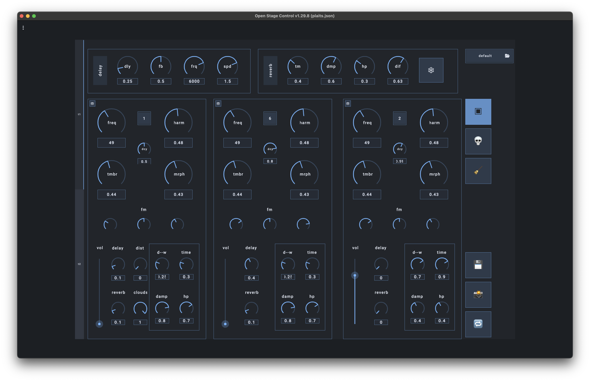
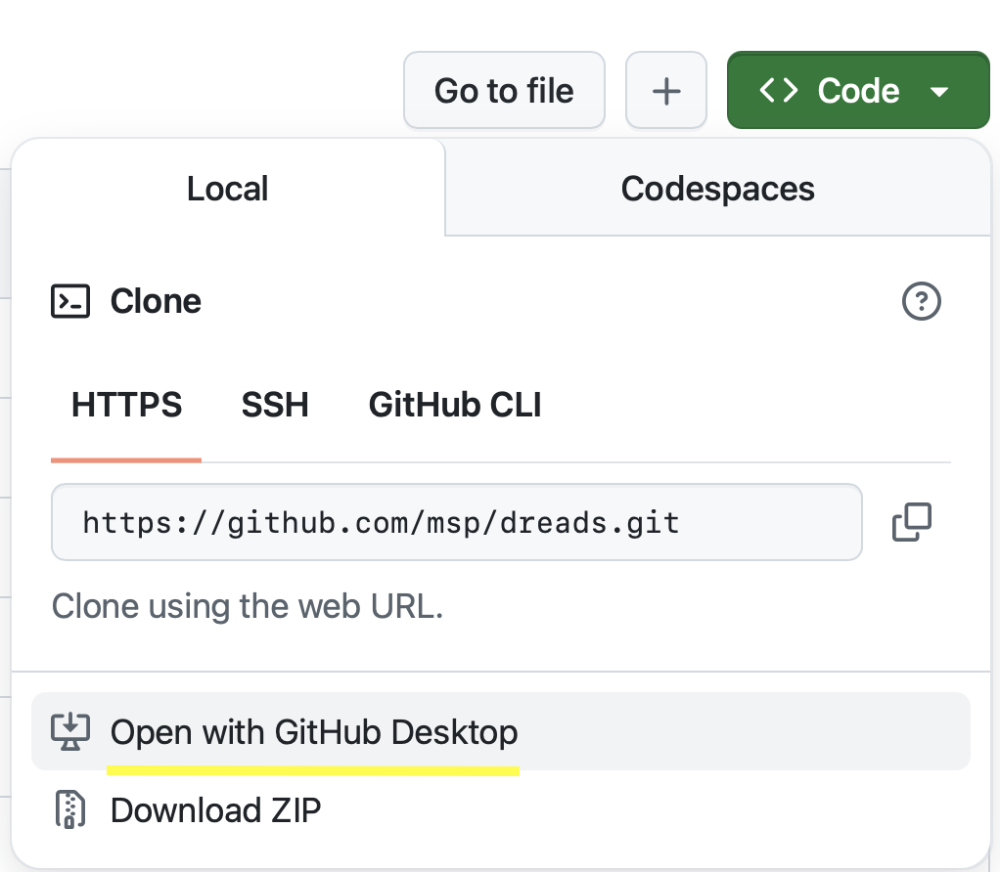
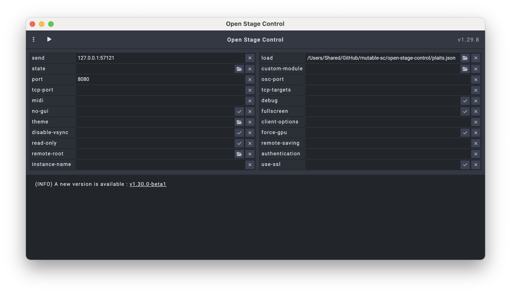

# Dreads

*Many twisted Plaits.*

Multi-instance Mutable Instruments Plaits synthesizer for Supercollider with patches, pattern sequencing, Open Stage Control user interface, live coding and OSC device targets.



## Requirements

- **SuperCollider 3.13+**
- **[Open Stage Control](https://openstagecontrol.ammd.net/)** — the UI control interface

The required SuperCollider extensions (MI-UGens — MiPlaits, MiVerb, MiClouds; and sc3-plugins — CrossoverDistortion) are **downloaded and installed automatically** on first run by the quick start below. No manual extension install needed.

## Quick start

1. **Get the project**
   - Install [GitHub Desktop](https://desktop.github.com/)
   - On the [Dreads repository page](https://github.com/msp/dreads), click **Code → Open with GitHub Desktop**, and choose where to save it

   

   *Didn't open the app? [Other ways to get the project](docs/manual-setup.md#getting-the-project).*

2. **Install the extensions** *(first run only)* — open `dreads.scd` in SuperCollider and run each line in turn (put the cursor in the line, press **Cmd+Enter**):

   ```supercollider
   (Document.current.dir ++ "/lib/commands.scd").load;   // brings ~app into scope — run this first
   ~app.install.();                                        // downloads + installs the SC extensions
   ```

   Then **restart SuperCollider** so it picks up the new extensions.

   > A restart clears everything, so re-run the `commands.scd` load line to bring `~app` back before starting.

3. **Start Dreads**

   ```supercollider
   (Document.current.dir ++ "/lib/commands.scd").load;   // ~app was cleared by the restart
   ~app.start.();                                          // boots the server, loads everything
   ```

   On later runs you only need these two lines — `~app.install` is for first run and after an extension update.

4. **Verify** — open `diagnostics.scd`, place the cursor inside the block, press **Cmd+Enter**, and check every UGen shows a ✓. If any show ✗, see [manual setup](docs/manual-setup.md).

5. **Launch the UI** — start Open Stage Control and configure the launch settings (three distinct ports — all must be set):
   - **send**: `127.0.0.1:57120` — where O-S-C sends control to SC (SC's `NetAddr.langPort`; check `diagnostics.scd`)
   - **osc-port**: `9000` — where O-S-C **receives** state from SC (must match `~ui` in `lib/globals.scd`). **Without this, controls work but the UI never updates from Dreads.**
   - **port**: `8080` — HTTP port the browser/iPad client connects to
   - **load**: path to `open-stage-control/plaits.json` in your project directory

   Or from the CLI:
   ```
   node app --send 127.0.0.1:57120 --osc-port 9000 --load <path>/open-stage-control/plaits.json
   ```
   Click the play button (▶) to start.

   

> **Something not working?** The auto-download, Gatekeeper warnings, audio device setup and all troubleshooting live in **[manual setup](docs/manual-setup.md)**.

## Usage

**UI Controls:**
1. **Load patch** — select from dropdown to load a saved patch
2. **Play/Stop** — start/stop pattern playback
3. **Snapshot** — capture current state to a new patch
4. **Save** — overwrite _current_ patch with current state
5. **Reload** — reload patch from last saved version

## Architecture

- **3 Plaits instances** with independent sequencing and modulation
- **Global send effects**: MiClouds, MiVerb, filtered ping-pong delay
- **Pattern-based sequencing** with per-instance duration/pitch/timbre control
- **Patch system** with auto-save and templating

## Project Structure

```
dreads.scd              # Main entry point
diagnostics.scd         # System diagnostics and troubleshooting
lib/
  commands.scd          # Install + start lifecycle (~app.install / ~app.start)
  globals.scd           # Configuration and defaults
  synthdefs.scd         # Audio engine definitions
  sequencer.scd         # Pattern sequencer
  lfo.scd               # LFO sources and modulation
  fx.scd                # Global send effects
  sequence_library.scd  # Named sequence patterns
  osc.scd               # OSC handlers and UI sync
  patches.scd           # Patch management
  utils.scd             # Helper functions
patches/dreads/         # Patch library
open-stage-control/     # UI definition
docs/manual-setup.md    # Manual install + troubleshooting
```
