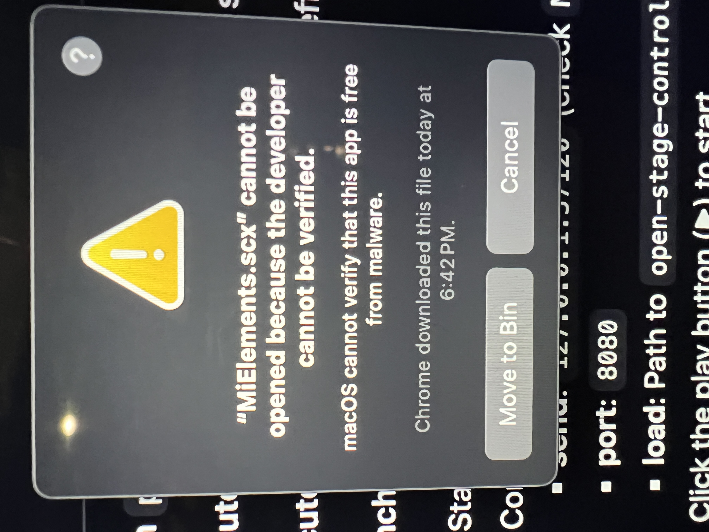

# Manual setup & troubleshooting

> **You should not normally need this.** The [README quick start](../README.md#quick-start) installs the
> SuperCollider extensions for you via `~app.install.()`. Use this guide only if the automatic
> download fails (a firewall blocks it, or the pinned release URLs have moved), or when something
> isn't working and you need to dig in.

## Getting the project

If **Code → Open with GitHub Desktop** on the repository page doesn't launch the app (some browsers just load the GitHub Desktop download page instead), clone it manually — any of:

- **GitHub Desktop**: *File → Clone Repository → URL*, paste `https://github.com/msp/dreads.git`, choose a location
- **Command line**: `git clone https://github.com/msp/dreads.git`
- **No git**: on the repository page, *Code → Download ZIP*, then unzip

## Manual extension install

If `~app.install.()` can't download the extensions, install them by hand.

1. **Download the extensions** for your SuperCollider version and architecture (Intel / Apple Silicon):
   - [MI-UGens](https://github.com/v7b1/mi-UGens/releases) (MiPlaits, MiVerb, MiClouds)
   - [sc3-plugins](https://github.com/supercollider/sc3-plugins/releases) (CrossoverDistortion)

   More info: [installing SuperCollider extensions](https://doc.sccode.org/Guides/UsingExtensions.html).

2. **Extract** the `mi-UGens/` and `sc3-plugins/` folders into your Extensions directory:
   ```
   /Library/Application Support/SuperCollider/Extensions/
   ```

3. **Allow the extensions through macOS Gatekeeper** (first time, and after any update):
   ```bash
   xattr -dr com.apple.quarantine "/Library/Application Support/SuperCollider/Extensions/mi-UGens"
   xattr -dr com.apple.quarantine "/Library/Application Support/SuperCollider/Extensions/sc3-plugins"
   ```

4. **Restart SuperCollider**, then run `diagnostics.scd` to confirm every UGen shows ✓.

## Open Stage Control

Install [Open Stage Control](https://openstagecontrol.ammd.net/docs/getting-started/introduction/#installation).

- **macOS**: if blocked by Gatekeeper or a "damaged and can't be opened" error, run:
  ```bash
  xattr -dr com.apple.quarantine /Applications/open-stage-control.app
  ```
  ([source](https://disable-gatekeeper.github.io))

## Audio device & speakers

`~app.install` creates `config.scd` (copied from `config.scd.example`, gitignored) on first run. Edit it
**before** `~app.start.()` to match your rig:

- `s.options.device` — your audio interface (leave `nil` for the system default output)
- `~numSpeakers` — `2` for stereo, `6` (etc.) for multichannel
- `~recordingMode` — defaults off (stereo mix); on routes each voice to its own bus for capture

## Troubleshooting

**Run diagnostics first.** Open `diagnostics.scd` in SuperCollider and execute the block — it verifies the
extensions are installed and prints your current configuration.

**No sound:**
- Check `s.meter` — are levels showing?
- In `config.scd`, confirm `s.options.device`, `~numSpeakers` and `~recordingMode` match your setup (see above)
- Run `~voiceGroup.freeAll` to clear stuck synths

**UI not responding:**
- Enable `OSCFunc.trace(true)` in SC to see incoming OSC messages
- Check Open Stage Control's **send** port matches `NetAddr.langPort` shown in diagnostics
- Verify the OSCdefs are loaded (did `~app.start.()` complete?)

**Controls work but the UI doesn't update from Dreads:**
- Open Stage Control's **osc-port** must be `9000` (matches `~ui` in `lib/globals.scd`). SC pushes state there; if it's unset or wrong, control still works but nothing reflects back.

**Extensions not loading:**
- Ensure the extensions match your SC version (3.13, 3.14, etc.) and architecture (Intel vs Apple Silicon)
- Restart SuperCollider after installing extensions
- Run `diagnostics.scd` to verify

**macOS security warnings for MI-UGens:**
- Re-run the `xattr` commands above (required after each extension update)
- Alternatively, go to **System Settings → Privacy & Security**, scroll down and click **"Allow Anyway"** for each blocked plugin, then restart SuperCollider
- More info: [Tidal Cycles forum thread](https://club.tidalcycles.org/t/mutable-instruments-ugens/2730/106)


